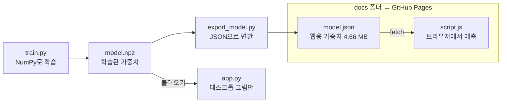

# TRD — 기술 요구사항 문서

작성일: 2026-11-04

## 기술 스택

| 영역 | 기술 | 선택 이유 |
| --- | --- | --- |
| 학습·예측 | Python 3.13, NumPy 2.5.4 | 이미 설치됨. PyTorch·TensorFlow·scikit-learn 없이 신경망 원리를 직접 구현 |
| 이미지 처리 | Pillow 13.0.0 | 그림판 이미지 자르기·축소·블러 |
| 데스크톱 UI | Tkinter | 파이썬 기본 포함, 추가 설치 없음 |
| 웹 | HTML, CSS, JavaScript (라이브러리 없음) | 서버 없이 브라우저에서 바로 예측 |
| 데이터 | MNIST (Google Cloud 미러) | 손글씨 숫자 표준 데이터 70,000장 |
| 버전 관리·배포 | Git 2.56, GitHub CLI 2.102, GitHub Pages | 무료 정적 호스팅 |

## 시스템 구조

학습은 내 PC의 파이썬에서 한 번 하고, 웹은 변환된 가중치만 받아 브라우저에서 예측한다.

데스크톱 앱은 `model.npz`를, 웹은 `model.json`을 읽는다. `docs` 폴더만 GitHub Pages에 배포된다.

## 모델 명세

| 항목 | 값 |
| --- | --- |
| 구조 | MLP 784 → 256 → 128 → 10 |
| 활성화 | 은닉층 ReLU, 출력층 소프트맥스 |
| 초기화 | He 초기화, 시드 0 |
| 손실 | 교차 엔트로피 |
| 최적화 | Adam (β1 0.9, β2 0.999), 학습률 0.001 → 6에폭 후 0.3배 |
| 배치·에폭 | 128 / 12 |
| 데이터 증강 | 상하좌우 최대 2픽셀 무작위 이동 |
| 입력 형식 | 28×28 흑백, 0~1 실수, 길이 784 벡터 |
| 저장 | `model.npz` — 키 W0, b0, W1, b1, W2, b2 (약 0.9 MB) |
| 결과 | MNIST 테스트 정확도 98.73% |

## 전처리 명세

그림판(280×280, 검은 배경에 흰 글씨, 붓 두께 20)을 MNIST 형식으로 바꾼다. 파이썬(`app.py`)과 JavaScript(`script.js`)는 같은 순서를 따른다.

1. 경계 상자로 자르기 — 아무것도 없으면 인식하지 않음
2. 긴 쪽 20픽셀로 축소 — 파이썬은 LANCZOS, JS는 영역 평균
3. 28×28 가운데 붙이기 + 가우시안 블러 — 파이썬은 반경 0.5, JS는 3×3 커널(0.1065, 0.787, 0.1065)
4. 무게중심을 (14, 14)로 이동

축소·블러 방식이 조금 달라 두 버전의 입력값이 완전히 같지는 않다. 사용자 테스트에서는 두 버전 모두 잘 인식했다.

## 웹 구현 명세

- **model.json 형식**: `{"layers":[{"inputSize","outputSize","weights","bias"}, ...]}`. `weights`는 행 우선으로 펼친 1차원 배열(`W[i][j] = weights[i × outputSize + j]`), 소수점 5자리, 약 4.66 MB.
- **모델 로딩**: `fetch("model.json")` 후 `Float32Array`로 변환. 그래서 `file://`로 열면 실패하고 HTTP 서버가 필요하다.
- **예측**: 층마다 행렬 곱 + 편향, 은닉층 ReLU, 마지막 소프트맥스. 입력이 0인 항은 건너뛰어 속도를 높인다.
- **입력**: Pointer 이벤트로 마우스·터치 공통 처리, `touch-action: none`으로 모바일 스크롤 방지, 화면 크기가 줄어도 좌표를 캔버스 크기로 환산.
- **스타일**: CSS 변수로 색상을 정의하고 `prefers-color-scheme`으로 다크 모드 적용.

## 배포 명세와 리스크

- **저장소**: [bestleeji-spec/handwritten-digit](https://github.com/bestleeji-spec/handwritten-digit) (공개), 브랜치 `main`
- **Pages 설정**: 브랜치 `main`, 폴더 `/docs`, HTTPS 강제
- **주소**: [https://bestleeji-spec.github.io/handwritten-digit/](https://bestleeji-spec.github.io/handwritten-digit/)
- **제외 파일**(`.gitignore`): `venv/`, `data/`, `__pycache__/`

| 리스크 | 영향 | 대응 |
| --- | --- | --- |
| `model.json`이 4.66 MB | 느린 망에서 첫 로딩 지연 | 소수점 자릿수 축소 또는 이진 형식 검토 |
| 파이썬·JS 전처리 차이 | 두 버전의 인식 결과가 다를 수 있음 | 같은 그림으로 비교 테스트 |
| MLP의 한계 | 판이한 필체는 오인식 | CNN으로 교체 검토 |
| 모델 재학습 후 변환 누락 | 웹에 이전 모델이 남음 | 재학습 후 반드시 `export_model.py` 실행 |
